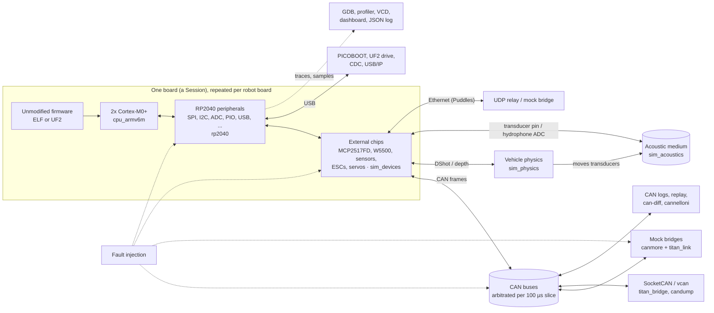

# firmware_simulator

[](https://github.com/ATK422/firmware_simulator/actions/workflows/ci.yml)

An RP2040 emulator, written in Rust, that runs the **unmodified** firmware of OSU UWRT's underwater robot boards:
[`titan_firmware`](external/titan_firmware) (C, pico-sdk) and [`titan_firmware_rs`](external/titan_firmware_rs)
(Rust, embassy). One board or a whole robot (Talos, Puddles) runs in one process, its boards on shared CAN buses,
with their sensors and actuators, the water between the acoustic modems and the vehicle the thrusters push. The
robot computer's side is a scripted mock bridge, or the real `titan_bridge` over SocketCAN. Runs are
**deterministic**, instruction for instruction, so firmware gets integration tests in CI, faults can be injected
and replayed exactly, and whole-robot scenarios can be tried without a robot, a pool or a bench of boards.

**Full guide: [docs/](docs/README.md)** · Design and milestones: [PLAN.md](PLAN.md)

- [What it can do](#what-it-can-do)
- [Quick start](#quick-start)
- [Boards, firmware and robots](#boards-firmware-and-robots)
- [Architecture](#architecture)
- [Performance and determinism](#performance-and-determinism)
- [Status and limitations](#status-and-limitations)
- [Contributing](#contributing)

## What it can do

| Area | Highlights | Docs |
|---|---|---|
| **CPU and chip** | Two Cortex-M0+ cores (the whole ARMv6-M Thumb set, exceptions, NVIC, SysTick, M0+ cycle counts); the official B1 bootrom running for real; direct, ROM and BOOTSEL boot; QSPI flash behind XIP; DMA, SPI, I2C, UART, ADC, PWM, both PIO blocks (cycle exact), USB device mode, watchdog and resets as on the chip | [internals.md](docs/internals.md#peripherals-and-their-modelling-status), [running.md](docs/running.md#boot-modes-and-the-flash) |
| **Boards and devices** | Board files generated from titan_firmware's board headers, plus hand-written overlays: MCP2517FD CAN FD, W5500 Ethernet, SHT41, MCP342x ADCs, MS5837 depth, SSD1306, BQ40Z80 gauge, DShot ESCs, Dynamixel and Hiwonder servos, WS2812, DRV8243; named physical inputs (`--input stbd_battery=15.1`) | [boards.md](docs/boards.md) |
| **Robots and the water** | Robot files with several boards on CAN FD and classic buses, power-on offsets and ID straps; acoustic environments (pool, open water, harbour) with multipath, noise and Doppler between IVC boards; a 6-DOF vehicle the firmware's DShot frames move, with depth sensors and transducers following it | [robots.md](docs/robots.md), [acoustics.md](docs/acoustics.md), [vehicles.md](docs/vehicles.md) |
| **Host integration** | Mock `titan_bridge` built on the real `canmore`/`titan_link` crates; SocketCAN (vcan) for the real host tools; Puddles over Ethernet/UDP; CAN log recording, replay and `can-diff`; cannelloni tunnels; `titan_bridge` command lines; USB with BOOTSEL, PICOBOOT, UF2 drive, CDC and USB/IP; GDB server | [robots.md](docs/robots.md#can-logs-recording-replaying-comparing), [running.md](docs/running.md#usb-bootsel-picoboot-uf2-and-cdc) |
| **Testing and faults** | The `sim_test` harness (`Bench`, `RobotBench`, snapshots, parallel sweeps); a smoke test for every board image; fault injection that fails the hardware, not the firmware's state (CAN bit errors, stuck bus, absent I2C devices, ADC shorts, brownouts, hangs, bridge loss, kill switch) | [testing.md](docs/testing.md), [faults.md](docs/faults.md) |
| **Developer tools** | Sampling firmware profiler with stack walks and flame-graph stacks; VCD waveforms with decoded traffic; a live web dashboard with fault, input and pause controls; JSON logs; instruction, exception, GPIO and device traces | [tools.md](docs/tools.md) |

## Quick start

**Prerequisites:** Rust (stable, 1.85 or newer) with the `thumbv6m-none-eabi` target, git, and read access to the
private repository `ATK422/titan_firmware_rs`. The C firmware additionally needs `gcc-arm-none-eabi`, `cmake` and
`ninja` (optional; only the C tests use it).

**1. Sources and toolchain.**

```bash
git clone https://github.com/ATK422/firmware_simulator && cd firmware_simulator
git submodule update --init       # external/titan_firmware_rs is private: ATK422/titan_firmware_rs
rustup target add thumbv6m-none-eabi
```

The workspace uses titan_firmware_rs's host crates (`canmore`, `titan_link`), so the emulator does not build
without that submodule. If cloning it fails, ask for access to `ATK422/titan_firmware_rs`.

**2. Build the firmware images and the emulator.**

```bash
(cd external/titan_firmware_rs/firmware && cargo build --workspace --release)
cargo build --release
alias firmware_simulator=$PWD/target/release/firmware_simulator
FW=external/titan_firmware_rs/firmware/target/thumbv6m-none-eabi/release
```

The images (`power_board`, `esc_board`, `ivc_board2`, ...) land in `$FW`. Built somewhere else (another checkout,
a worktree)? Point `TITAN_RS_RELEASE_DIR` there; tests and robot files follow it. For the C programs (the template,
the Titan bootloader), run `git -C external/titan_firmware submodule update --init --recursive` and
`scripts/build_c_firmware.sh`.

**3. Run one board** next to a mock bridge for its CANmore client (1), for two seconds of virtual time:

```bash
firmware_simulator run $FW/power_board --board boards/mk2/power_board.toml --mock-bridge 1 --time 2s
```

```
[INFO  firmware_simulator] board mk2/power_board (1 SPI, 2 I2C device(s); inputs: port_battery, rail_3v3, rail_balanced, sht41.humidity_rh, sht41.temperature_c, stbd_battery)
[INFO  firmware_simulator] direct boot: VTOR 0x10000100, entry 0x100001c0
[INFO  firmware_simulator] RTT control block at 0x20000008, decoding defmt
[INFO  firmware_simulator] mock bridge for client 1 attached
[0.132000s] 0.000025 INFO  mk2/power_board v1.0 (release type 2, git 342ee0d)
[0.132000s] 0.000123 INFO  Crash counts since power on: CrashCounts { watchdog_timeouts: 0, panics: 0 }
[0.135200s] 0.003300 INFO  CAN controller online as client 1
[0.200400s] 0.068450 INFO  ROS connected
stopped at 2.000000s (TimeLimit); core0 234375135 cycles, pc 0x1000039c <<embassy_executor::platform::thread::Executor>::run::<power_board::__cortex_m_rt_main::{closure#0}>+0x94>; 43.26ms wall
core1 249575205 cycles, pc 0x00000176, Some(Wfe)
```

Each firmware line shows the virtual time it was read, the firmware's own defmt timestamp, the level and the
message. Then try `--candump` (CAN frames), `--input stbd_battery=15.1` (a sensor value),
`--fault 1s@bridge-stop` (take the bridge away) or `--trace gpio` (pin changes); `firmware_simulator run --help`
lists the rest ([running.md](docs/running.md)).

**4. Run a whole robot:** Talos's nine boards on its internal CAN FD and external classic buses, with mock bridges
for the PoAC board (client 1) and the smart battery (client 21):

```bash
firmware_simulator robot robots/talos.toml --mock-bridge internal:1 --mock-bridge external:21 --time 1s
```

```
[INFO  firmware_simulator] 9 board(s) on 2 bus(es)
[INFO  firmware_simulator] mock bridge for client 1 on internal
[INFO  firmware_simulator] mock bridge for client 21 on external
[0.131600s] sbc: 0.000023 INFO  talos/sbc_board v1.0 (release type 2, git 342ee0d)
...
[0.133700s] esc0: 0.000014 INFO  ESC board 0 (thrusters 0-3), client ID 2
[0.134500s] battery: 0.000012 INFO  Board serial number 21
[0.134900s] ivc: 0.000158 INFO  This board is talos
[0.135400s] poac: 0.003339 INFO  CAN controller online as client 1
[0.136700s] esc1: 0.000014 INFO  ESC board 1 (thrusters 4-7), client ID 3
...
[0.165600s] battery: 0.031138 INFO  Connected to gauge, serial 21
[0.200400s] poac: 0.068333 INFO  ROS connected
[0.200700s] battery: 0.066214 INFO  ROS connected
[0.265800s] ivc: 0.131092 INFO  CAN controller online as client 8
stopped at 1.000000s; 4.43s wall
vehicle talos: at [5.00, 6.00, 0.25] m, roll 0.0 pitch 0.0 yaw 0.0 deg, 0.00 m/s
```

Each line carries the board's name (`...` marks lines left out here); the run ends with the wall time and each
vehicle's pose. Talos runs slower than real time on one core ([performance](#performance-and-determinism)). Other
robots: `robots/puddles.toml` with `--eth-mock-bridge backplane`, the IVC pools with a mock bridge per vehicle
([robots.md](docs/robots.md#the-robot-command)).

**5. Run the tests.**

```bash
cargo test --release -p sim_test --test smoke -- --nocapture   # every board image on its board
cargo test --release --workspace                              # everything (several minutes)
```

```
board               connected   statuses  faults      wall
template            0.200401s          2  0x00000000  334.00ms  mk2/power_board
power_board         0.200400s          2  0x00000000  375.41ms  mk2/power_board
esc_board           0.200401s          2  0x00000000   2.73s  mk2/esc_board
...
smart_battery       0.200701s          2  0x00000000  355.65ms  mk2/sbh_mcu
hbridge_board       0.200400s          2  0x00000000  407.49ms  lilboat/hbridge_board
po_half_board       0.200400s          2  0x00000000  380.73ms  lilboat/po_half
test every_board_boots_and_connects ... ok
```

Always test in release mode. Tests whose firmware is not built print `skipping: ...` and **pass**, so check with
`--nocapture` that a green run really ran the firmware. To write a test, start from
[the walkthrough](docs/testing.md#a-first-test-step-by-step).

## Boards, firmware and robots

Every titan_firmware_rs image and the board file the smoke test boots it on (the board files live in
[`boards/`](boards), generated from titan_firmware's headers plus [`boards/overlays/`](boards/overlays)):

| titan_firmware_rs image | Board file | Client | What is modelled around it |
|---|---|---|---|
| `power_board`, `template` | `mk2/power_board` | 1 | MCP2517FD, SHT41, MCP3426 with the port and starboard battery voltages |
| `esc_board` | `mk2/esc_board` | 2 (3 with ID strap GPIO 29 high) | MCP2517FD, four DShot ESCs (bidirectional eRPM, KISS telemetry, motor lag), supply voltage |
| `camera_cage_bb` | `mk2/camera_cage_bb` | 4 | MCP2517FD, MS5837-02BA depth sensor, SHT41, WS2812 status strip |
| `actuator_board` | `mk2/actuator_board` | 5 | MCP2517FD, two Dynamixel X-series servos, WS2812 status strip |
| `led_board`, `led_board2` | `talos/led_board` | 6 | MCP2517FD |
| `sbc_board` | `talos/sbc_board` | 7 | MCP2517FD |
| `ivc_board`, `ivc_board2`, `ivc_dac` | `talos/ivc_board` | 8 | MCP2517FD, the acoustic transducer (drive pin, hydrophone receive chain into the ADC) |
| `poac_board` | `talos/poac_board` | 1 | MCP2517FD, SHT41, MCP3426, Hiwonder bus servo |
| `smart_battery` | `mk2/sbh_mcu` | 21 | MCP2517FD (external bus), SHT41, SSD1306 display, BQ40Z80 gauge on PIO SMBus, serial number in flash |
| `hbridge_board` | `lilboat/hbridge_board` | 2 | MCP2517FD, DRV8243 H-bridges, analog mux |
| `po_half_board` | `lilboat/po_half` | 1 | MCP2517FD, two MS5837-02BA, SHT41, MCP3426, tank and regulated pressure inputs |
| `puddles_backplane` | `mk2/puddles_backplane` | Ethernet | W5500 (UDP to the robot computer), MS5837-30BA, MCP3426, eight DShot ESCs, kill switch |

Every board also has its QSPI flash, debug UART and pins. The C programs (`basic_template`, the Titan bootloader
and its OTA test app) run on these board files in `sim_host`'s `pico_sdk`, `flash` and `can` tests.

The generator also writes files for boards that have no titan_firmware_rs image yet (`boards/mk1/*`,
`boards/mercury/*`): their CAN controller and pins, without device overlays.
[boards.md](docs/boards.md#which-board-file-for-which-image) has every table and field.

| Robot file | What it is |
|---|---|
| [`robots/talos.toml`](robots/talos.toml) | Talos: PoAC, two ESC boards, camera cage, actuator, LED, SBC and IVCBoard2 on the internal CAN FD bus, the smart battery on the external classic bus, the Talos vehicle |
| [`robots/puddles.toml`](robots/puddles.toml) | Puddles: the backplane over Ethernet, in the Puddles vehicle |
| [`robots/ivc_pool.toml`](robots/ivc_pool.toml) | Two vehicles in `environments/pool.toml`, each with a first-generation IVCBoard on its own bus |
| [`robots/ivc2_pool.toml`](robots/ivc2_pool.toml) | The same with IVCBoard2 |

Environments: [`pool`, `open_water`, `harbour`](environments) ([acoustics.md](docs/acoustics.md#environment-files)).
Vehicles: [`talos`, `puddles`](vehicles) ([vehicles.md](docs/vehicles.md#vehicle-files)).

## Architecture

| Crate | What it does |
|---|---|
| [`sim_core`](crates/sim_core) | Virtual time (picoseconds), the event scheduler, `Bus`/`Peripheral`/`Cpu` traits, wires, traces, ELF/UF2 images, snapshots |
| [`cpu_armv6m`](crates/cpu_armv6m) | The Cortex-M0+ interpreter: ARMv6-M Thumb, exceptions, NVIC, SysTick, SCB, cycle counts, batched execution |
| [`rp2040`](crates/rp2040) | The SoC: memory map, peripherals, bootrom, the unmodelled-register fallback, the two-core `Machine` and its run loop |
| [`sim_devices`](crates/sim_devices) | External chips: the CAN bus, MCP2517FD, W5500, sensors, PIO-driven devices, USB host controller, fault injectors |
| [`sim_acoustics`](crates/sim_acoustics) | Water, transducers, receive chains, multipath, the shared acoustic medium |
| [`sim_physics`](crates/sim_physics) | The 6-DOF vehicle model |
| [`sim_host`](crates/sim_host) | Sessions and robots, board and robot files, mock bridges, SocketCAN, UDP, GDB, USB tools, CAN logs, faults, profiler, VCD, dashboard |
| [`sim_test`](crates/sim_test) | The firmware test harness: `Bench`, `RobotBench`, `sweep` |
| `firmware_simulator` (root) | The command line: `run`, `robot`, `can-diff`, `bridges`, `can-tunnel`, `picoboot` |

Dependencies point one way: `sim_core` ← `cpu_armv6m`, `sim_devices`, `sim_acoustics`, `sim_physics` ← `rp2040`
← `sim_host` ← `sim_test` and the CLI. How a board's firmware reaches the buses, the water and the host:



All boards of a robot advance to the same virtual time in 100 µs slices; after each slice the buses arbitrate
and deliver, devices update their pins, vehicles step and the acoustic medium hears each board's progress.
[internals.md](docs/internals.md) covers the run loop, how to add a peripheral or device model, and snapshots.

## Performance and determinism

Measured with `cargo run --release -p sim_test --example bench -- --time 2s --repeat 3` on a shared 4-core machine
(CPU time for 2 s of virtual time; above 1x keeps up with `--realtime`):

| Run | CPU time | Speed vs real time |
|---|---|---|
| `template` (power board) | 0.03 s | about 60x |
| IVCBoard2 | 0.6 s | about 3.4x |
| ESC board (four DShot ESCs on PIO) | 1.8 s | about 1.1x |
| IVC2 pool (two boards in the water) | 2.2 s | about 0.9x |
| Talos (nine boards) | 4.7 s | about 0.4x |

So single boards run at or above real time, and all of Talos with `--realtime` does not keep up on one core
(`--threads` can help on an idle multi-core machine). Details: [internals.md](docs/internals.md#performance),
[robots.md](docs/robots.md#how-a-robot-runs).

**Determinism.** The same image, board or robot file, inputs, faults and seeds give the same run, instruction for
instruction and frame for frame: models never read the wall clock (only `--realtime` pacing does, to sleep), all
randomness is seeded, iteration orders are fixed, `--threads` gives the same results as taking turns, and observers
(traces, waveforms, the profiler) do not change what the machine does. Tests, replay, `can-diff` of two runs and
the benchmark's fingerprints rely on it ([internals.md](docs/internals.md#determinism-rules)).

## Status and limitations

Milestones M0 to M7 of [PLAN.md](PLAN.md) are implemented, followed by performance and hardening work. What is
not modelled or not yet trusted:

* **Peripherals**: no SPI/I2C slave modes, USB host mode or isochronous endpoints, sleep/dormant modes, RTC or
  SYSCFG (unmodelled registers are stored, and logged on first access); the MPU is stored, not enforced
  ([the table](docs/internals.md#peripherals-and-their-modelling-status)).
* **Physics are assumptions**: the acoustic numbers (transducers, filters) and every vehicle parameter are
  plausible values, not calibrated against recordings, CAD or tank data. Use them to compare and catch
  regressions, not to prove range or dynamics ([acoustics.md](docs/acoustics.md),
  [vehicles.md](docs/vehicles.md#limitations)).
* **C board applications**: titan_firmware's C board apps need its prebuilt micro-ROS library (built in Docker),
  so `scripts/build_c_firmware.sh` builds only the template, the Titan bootloader and its test app.

**To verify locally.** The cloud environment this was built in has no vcan module or `CAP_NET_ADMIN`, ROS 2,
Docker daemon, vhci-hcd module or hardware. These are written and statically checked, but never run for real:

* SocketCAN on vcan with the real `titan_bridge`, `canmore_cli` and `upload_tool`, and the `bridges` script and
  launch file in `riptide-shell` ([robot in a box](docs/robots.md#robot-in-a-box-vcan-titan_bridge-docker)).
* The `docker/robot_computer` image and compose file.
* `--usbip` against the kernel's vhci-hcd (tested only with an in-process USB/IP client).
* The micro-ROS C board images; VCD files in GTKWave/Surfer/PulseView; the dashboard in a real browser
  ([tools.md](docs/tools.md#to-verify-locally)).

**CI** ([`.github/workflows/ci.yml`](.github/workflows/ci.yml)) has two jobs: **test** builds the
titan_firmware_rs images, runs `cargo fmt --all --check`, `cargo clippy --workspace --all-targets --release -- -D warnings`,
`python3 scripts/gen_boards.py --check` and every test, then prints the smoke and sweep tables; **c-firmware**
builds the C programs and runs the tests that boot them. Both need the repository secret
**`TITAN_FIRMWARE_RS_TOKEN`**: a fine-grained token with "Contents: read" on `ATK422/titan_firmware_rs`. Without it
the firmware step fails loudly ([testing.md](docs/testing.md#ci)).

## Contributing

* Follow [PLAN.md](PLAN.md) for the design; [internals.md](docs/internals.md) explains the code and how to add
  peripherals and device models.
* Every instruction, peripheral and device behaviour gets a test (register-level from the datasheet, then with a
  program or firmware). Keep `cargo fmt --all` and `cargo clippy --workspace --all-targets --release` clean.
* Never modify anything under `external/`. When the firmware rather than the emulator looks wrong, write a
  `firmware_finding_*` test that pins today's behaviour and add it to
  [faults.md](docs/faults.md#firmware-findings-so-far).
* Board files are generated: edit `boards/overlays/` and rerun `python3 scripts/gen_boards.py`.
* The docs are tested: `cargo test --release --test docs` checks that every `firmware_simulator` command, option
  and relative link in this README and in `docs/` exists.

## Third-party data

* `crates/rp2040/svd/rp2040.svd`: from the pico-sdk, BSD-3-Clause.
* `crates/rp2040/bootrom/b1.bin`: the official RP2040 B1 bootrom, BSD-3-Clause; see
  [its README](crates/rp2040/bootrom/README.md).
